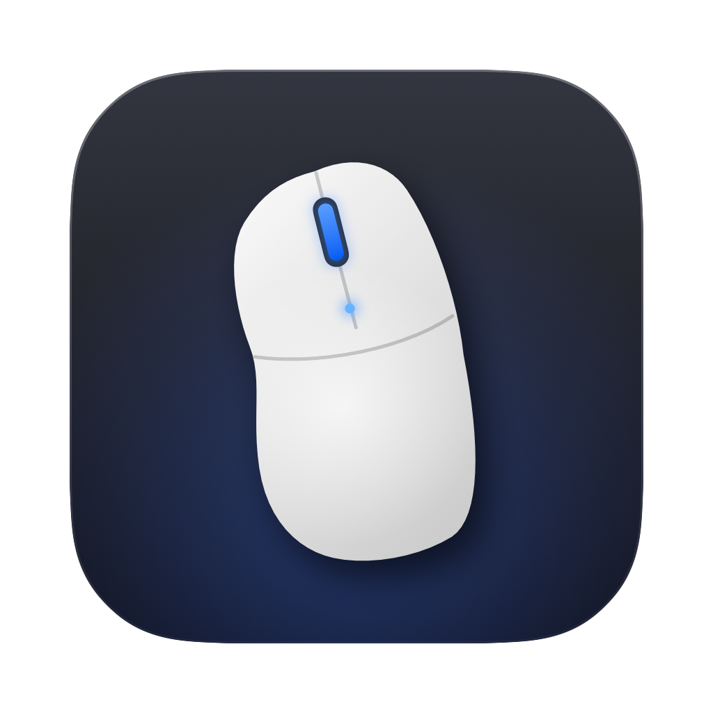
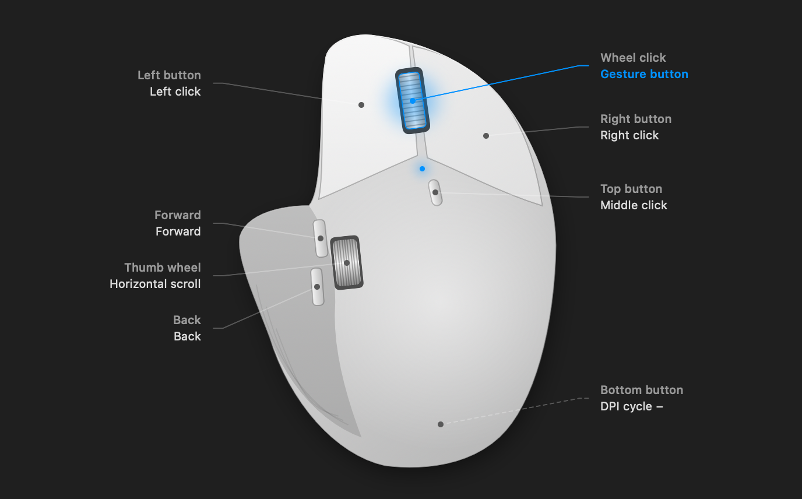

<p align="center"></p>

<h1 align="center">MT Control</h1>

<p align="center">A Mac app for setting up the Rapoo MT760 / MT760L mouse.<br>Free, open source, and made for Apple silicon Macs.</p>

<p align="center"><a href="https://github.com/spundone/rapoo-mt760-mac/releases/latest"><b>Download the latest version</b></a></p>

<p align="center"></p>

---

## Why this exists

Rapoo's own app, A HUB, was built for Intel Macs, so on newer Macs it runs through Apple's Rosetta translator. Its shortcut buttons also send Windows key combinations: "Copy" sends Ctrl+C, which does nothing on a Mac. MT Control is a small, native replacement that speaks Mac.

It's an unofficial app, made by a user. Rapoo isn't involved.

## What you can do

**Settings stored inside the mouse.** They stay with the mouse, even on another computer.
- Pick the speed (DPI) the mouse is on, change the speed of each of its 7 stages, and choose how many stages the button cycles through.
- Change the polling rate: how often the mouse reports to the computer (125–1000 times a second).
- Choose what the top button and the button underneath do (for example, step the speed up or down).
- See the battery level and whether it's charging.

**Mac features, a bit like Logitech Options+.** These work while MT Control is running.
- Set the wheel click, back and forward buttons to Mac actions: Mission Control, show all windows of an app, show the desktop, switch desktops, any keyboard shortcut, or a different mouse button.
- Gesture button: hold a button and move the mouse up, down, left or right for different actions.
- Different settings for different apps. You can even have the mouse change speed automatically when you switch to a particular app.
- Scrolling: reverse the wheel direction without changing your trackpad, turn on smooth scrolling, change the scroll speed.
- A warning when the battery is low, the battery level in the menu bar, and start at login.

## What you need

- A Mac with Apple silicon (M1 or newer) on **macOS 26 Tahoe** or later.
- The MT760's **2.4 GHz USB receiver** plugged in, with the mouse switched to receiver mode. Bluetooth isn't supported yet.

## Install

1. Download `MT-Control.zip` from the [latest release](https://github.com/spundone/rapoo-mt760-mac/releases/latest) and double-click it to unzip.
2. Drag **MT Control** into your **Applications** folder.
3. Open it. The app isn't notarised by Apple (that costs $99 a year), so the first time macOS will say it can't check it:
   - Click **Done** (or **OK**).
   - Open **System Settings → Privacy & Security**, scroll down to the message about MT Control, and click **Open Anyway**.
   - Enter your password if asked. After this, it opens normally.

## The first time you open it

macOS asks for permission twice. Here's why each one is needed.

| Permission | When it's asked | Why |
|---|---|---|
| **Input Monitoring** | Straight away | The receiver passes settings through the same USB connection a keyboard uses, so macOS treats talking to it like reading a keyboard. MT Control doesn't record your typing. |
| **Accessibility** | Only when you first change a button action or a scrolling setting | Lets the app catch a mouse button press and turn it into something else, like Mission Control. |

To give permission: open **System Settings → Privacy & Security**, open the section macOS points you to, and turn on **MT Control**. Then quit and reopen the app.

If the mouse doesn't show up, move it to wake it up. MT Control keeps trying every few seconds.

## Common questions

**Do I still need Rapoo's A HUB?**
No. Close A HUB while using MT Control, because both apps talk to the mouse through the same channel.

**Is it safe for my mouse?**
MT Control only changes the same settings A HUB does, using the same commands. After every change it reads the setting back from the mouse to check it worked. It never lets you change the left button, so you can't end up without a left click. It doesn't update firmware.

**How do I undo a change?**
Every setting can be changed back in the app. The mouse's own button still cycles speeds as normal.

**Why do my other mice follow the same button settings?**
macOS doesn't tell apps which mouse a click came from, so the Mac-side button actions apply to every mouse. Settings stored inside the mouse (speed, polling rate, top and bottom buttons) only affect the MT760.

**Does it work with other Rapoo mice?**
It's only been tested on the MT760L. Other mice that use the same receiver may partly work, but nothing is promised.

**Where are my settings saved?**
Speed, polling rate and the top and bottom buttons are saved in the mouse. Mac-side button actions, gestures, scrolling and app profiles are saved on your Mac.

## How it works

[docs/how-it-works.md](docs/how-it-works.md) explains in plain English how the app talks to the mouse and how the Mac features work. Developers can find the detailed protocol notes in [docs/protocol.md](docs/protocol.md).

## For developers

Building needs the Xcode Command Line Tools (`xcode-select --install`); Xcode itself isn't required.

```sh
./scripts/bundle.sh     # builds dist/MT Control.app
./scripts/test.sh       # runs the tests
./scripts/make-icon.sh  # re-renders the app icon from AppIconArt.swift
```

- The app is SwiftUI with Liquid Glass, and talks to the mouse through IOKit HID.
- `bundle.sh` signs with a local identity named "MT Control Local Signing" if your keychain has one, or ad hoc otherwise. A fixed identity keeps macOS permissions across rebuilds.
- Every message sent to and from the mouse is logged to `~/Library/Logs/MTControl/hid.log`.
- **Device → Snapshot memory** saves the mouse's settings memory to that log, which helps when working out new settings.
- The icon and the mouse picture are drawn in code. No Rapoo artwork is used.

Bug reports and pull requests are welcome. If you have a different Rapoo mouse, a snapshot log from it would help add support.

## License

MIT. See [LICENSE](LICENSE).
